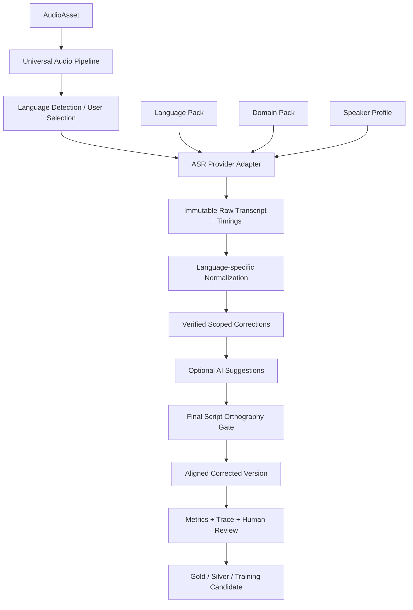

# ארכיטקטורה רב-לשונית למערכת התמלול

**פרויקט:** `chai-transcribe`  
**תאריך:** 2026-09-02  
**מטרה:** להגדיר כיצד מערכת התמלול יכולה לשפר עברית, לשון הקודש ושפות נוספות באמצעות אותה תשתית, בלי להחיל כללים של שפה אחת על שפה אחרת.

---

## מסקנה

כן, הטכנולוגיה הבסיסית משותפת לכל השפות:

- קליטת אודיו ושיפור איכות.
- VAD וחלוקה למקטעים.
- זיהוי שפה.
- הפעלת מנוע ASR.
- contextual biasing / hotwords.
- תזמוני מילים ויישור.
- גרסאות, Human Review ו-Gold.
- WER, CER, בדיקות חזרתיות והזיות.
- אימון או adapter ייעודי.
- trace ולוגים.

אבל הידע הלשוני אינו משותף:

- מנצפ״ך רלוונטי לעברית בלבד.
- כללי כתיב, פיסוק, הטיות ומורפולוגיה שונים בכל שפה.
- מילון תורני הוא חבילת תחום בעברית/ארמית, לא מילון כללי לכל העולם.
- תיקון שנלמד בשפה אחת אסור שיופעל בשפה אחרת.

הארכיטקטורה הנכונה היא **ליבה רב-לשונית אחת עם Language Packs ו-Domain Packs מבודדים**.

---

## מה אומרים המקורות המקצועיים

### Whisper הוא רב-לשוני, אך אינו שווה באיכותו בכל שפה

ה-Model Card הרשמי של OpenAI מתאר מודלים רב-לשוניים ומציין שנתוני האימון כללו 98 שפות. הוא גם מזהיר שביצועי התמלול אינם אחידים בין שפות, מבטאים ודיאלקטים, ושיש לבצע הערכה חזקה בכל תחום לפני פריסה. בנוסף מצוינות נטייה להזיות ולחזרתיות.

מקור: [OpenAI Whisper Model Card](https://github.com/openai/whisper/blob/main/model-card.md)

### Whisper משתמש בהקשר ולא רק בצליל המקומי

המימוש הרשמי כולל `condition_on_previous_text`, שמעביר את הפלט הקודם כ-prompt לחלון הבא. הוא כולל גם `initial_prompt`, זיהוי שפה, ספי log probability ו-compression ratio, ו-word timestamps. לכן התחושה שההמשך עשוי להיות חזק יותר מההתחלה סבירה מבחינה טכנית: בחלונות מאוחרים יותר יכול להיות למודל הקשר קודם. עם זאת, אותו מנגנון עלול גם לגרור שגיאה או להיכנס ללולאת חזרות.

מקור: [OpenAI Whisper transcribe.py](https://github.com/openai/whisper/blob/main/whisper/transcribe.py)

### faster-whisper כבר חושף את אבני הבניין הנדרשות

`faster-whisper` תומך ב-language, ב-hotwords, ב-initial prompt, ב-previous text conditioning, ב-word timestamps, ב-beam search ובספי fallback. כלומר אין צורך להמציא מנוע חדש כדי ליצור ליבה רב-לשונית; צריך לנהל נכון את ההגדרות והנתונים שסביבו.

מקור: [faster-whisper transcribe.py](https://github.com/SYSTRAN/faster-whisper/blob/master/faster_whisper/transcribe.py)

### Context biasing הוא שיפור בזמן הפענוח, לא החלפת טקסט עיוורת

NVIDIA NeMo מתעדת Word/Phrase Boosting שמעלה את ההסתברות למונחים ולביטויים בזמן decoding, בלי לאמן מחדש. NeMo גם מתארת scoring וסינון שנועדו למנוע false accepts של מונחים מוטים.

מקורות: [NeMo Word Boosting](https://docs.nvidia.com/nemo/speech/nightly/asr/asr_customization/word_boosting.html), [NeMo ASR Customization](https://docs.nvidia.com/nemo/speech/nightly/asr/asr_language_modeling_and_customization.html)

### Fine-tuning ניתן לביצוע לכל שפה ולכל dataset מתאים

Hugging Face מספקת תהליך רשמי ל-fine-tuning של Whisper על datasets רב-לשוניים ועל datasets מותאמים. השיפור תלוי באיכות האודיו והתוויות ובהפרדת train/eval, לא רק בשם השפה.

מקורות: [Fine-Tune Whisper for Multilingual ASR](https://huggingface.co/blog/fine-tune-whisper), [Transformers Speech Recognition Examples](https://github.com/huggingface/transformers/blob/main/examples/pytorch/speech-recognition/README.md)

### אפשר להחזיק adapters נפרדים

PEFT תומכת בכמה adapters בעלי שמות נפרדים ובבחירת adapter פעיל. רעיונית אפשר להחזיק base model משותף ו-adapters נפרדים לשפה, תחום או דיאלקט, במקום למזג הכול למודל בלתי הפיך אחד.

מקור: [Hugging Face PEFT Quicktour](https://huggingface.co/docs/peft/main/quicktour)

---

## מצב הפרויקט כיום

### מה כבר רב-לשוני

- בחירת שפה ומנועי ASR שונים.
- מודל CUDA רב-לשוני כברירת fallback.
- ספקי OpenAI, Groq, Google, AssemblyAI, Deepgram ו-Gemini.
- קליטת קובץ, תור, שמירה, גרסאות וענן.
- תשתית אודיו, תזמונים ו-Human Review.
- תשתית dataset ו-LoRA.
- השוואת A/B ומדדים.

### מה עדיין עברי בלבד

1. `src/lib/transcriptionLanguages.ts:68-74` מפעיל את שרשרת הידע רק כאשר השפה שנבחרה או זוהתה היא `he`.
2. `src/lib/transcriptionKnowledge.ts` בנוי סביב תיקונים נלמדים, מילון עברי, פרופיל הגייה, לשון הקודש, מנצפ״ך ו-AI עברי.
3. `src/lib/asrMetrics.ts` משתמש ב-`tokenizeHebrew` וב-`normalizeHebrew`, ולכן WER/CER אינם generic באמת.
4. `computeTermRecall` מסומן וממומש סביב מונחים עבריים.
5. prompt ו-hotwords ברירת המחדל בשרת CUDA הם עבריים כאשר `language=he`.

### הסיכון החשוב ביותר לרב-לשוניות

`CorrectionEntry` ב-`src/utils/correctionLearning.ts` שומר engine ו-category, אך לא שומר language, domain, speaker או audio span. המאגר הוא:

```text
localStorage: transcription_corrections
```

לכן תיקון שנלמד בעברית אינו מבודד מבנית מתיקון בשפה אחרת. לפני הפעלת למידה כללית לכל שפה צריך להוסיף scope מחייב.

---

## הארכיטקטורה המומלצת



### 1. Universal Core

הליבה אינה מכירה מנצפ״ך, מסכתות או דקדוק אנגלי. היא אחראית על:

- זהות קובץ ו-hash.
- preprocessing ו-VAD.
- adapters למנועי תמלול.
- progress, retry ו-quality gates.
- raw transcript ו-word timings בלתי משתנים.
- alignment וגרסאות.
- audit trace.
- datasets, splits ו-model registry.

### 2. Language Pack

לכל שפה חבילה מפורשת:

```ts
interface LanguagePack {
  id: string;
  locale: string;
  script: string;
  normalizeForMetrics(text: string): string;
  tokenize(text: string): string[];
  applyHardOrthography(text: string): RuleResult;
  buildDefaultPrompt(context: RunContext): string | undefined;
  buildHotwords(context: RunContext): WeightedTerm[];
  qualityChecks: QualityCheck[];
}
```

דוגמאות:

- `he`: מנצפ״ך, ניקוד, גרשיים וקיצורים עבריים.
- `en`: apostrophes, casing וכללי tokenization באנגלית.
- `ar`: צורות Unicode, ניקוד וכתיב ערבי.
- שפה שאין לה חבילה ייעודית משתמשת ב-pack ניטרלי שאינו משנה מילים.

### 3. Domain Pack

תחום אינו שפה:

```text
language=he
domain=torah
dialect=ashkenazi
sampleType=natural-speech
```

Domain Pack תורני יכול להכיל:

- מסכתות, תנאים ואמוראים.
- מפרשים וספרים.
- ארמית וביטויים רבניים.
- phrases מותאמים להקלטה.
- מדדי Term Recall ו-Term Precision.

אותו מנגנון יכול לשרת גם רפואה באנגלית, משפטים בצרפתית או שמות מוצרים בגרמנית.

### 4. Speaker/Dialect Profile

פרופיל דובר צריך להיות שכבה נפרדת:

- מזהה דובר או פרופיל.
- שפה ודיאלקט.
- תיקונים שנצפו אצל אותו דובר.
- מספר הקלטות בלתי תלויות שתומכות בתיקון.
- confidence והקשר.

אסור לתיקון של דובר אחד להפוך אוטומטית לכלל שפה.

### 5. Model/Provider Adapter

כל ספק מקבל יכולות מפורשות:

```ts
interface AsrProviderCapabilities {
  languages: string[] | 'multilingual';
  supportsHotwords: boolean;
  supportsPrompt: boolean;
  supportsWordTimings: boolean;
  supportsLanguageDetection: boolean;
  supportsStreaming: boolean;
}
```

כך לא נציג B “עם ידע” כאשר הספק כלל לא קיבל hotwords.

---

## סוגי ידע שאסור לערבב

| סוג | דוגמה | מתי מופעל | סמכות |
|---|---|---|---|
| כלל כתב קשיח | מנצפ״ך | בסוף | מוחלט בתוך השפה |
| contextual bias | `ארוממך`, שם אדם | בזמן decoding | מעלה הסתברות בלבד |
| תיקון אנושי מאומת | span שנבדק מול האודיו | אחרי ASR או לאימון | גבוה, עם scope |
| כלל דיאלקט | הגייה אשכנזית | רק בפרופיל המתאים | תלוי שפה/דובר |
| AI editor | פיסוק וניסוח | הצעה או גרסה נפרדת | אינו Gold אקוסטי |
| כלל גלובלי | `ילדים → ילדות` | אסור כברירת מחדל | מסוכן ללא הקשר |

---

## סכמת תיקון מומלצת

כל תיקון צריך להכיל לפחות:

```ts
interface ScopedCorrection {
  id: string;
  sourceText: string;
  targetText: string;
  language: string;
  domain?: string;
  dialect?: string;
  speakerProfileId?: string;
  engine?: string;
  sourceRecordingId: string;
  audioStart: number;
  audioEnd: number;
  correctionType: 'acoustic' | 'orthographic' | 'punctuation' | 'editorial';
  evidenceTier: 'candidate' | 'silver' | 'gold';
  confidence: number;
  verifiedBy?: string;
  createdAt: string;
}
```

בלי `language` ו-`correctionType`, אסור להחיל תיקון אוטומטית.

---

## צורת הניסוי לכל שפה

לא משווים רק “לפני ואחרי”. מריצים מטריצה קבועה:

| וריאנט | תיאור |
|---|---|
| A | מודל בסיס, ללא מונחים אישיים וללא post-processing |
| B | אותו מודל עם Language Pack ו-contextual terms |
| C | אותו פענוח עם corrections מאומתים בלבד |
| D | adapter/fine-tuned model ייעודי |
| E | AI linguistic editor כגרסה נפרדת, לא כתמלול אקוסטי |

מדדים לכל שפה:

- WER עם normalizer של אותה שפה.
- CER גולמי ו-CER מנורמל.
- Strict orthography error.
- Term Recall וגם Term Precision.
- hallucination/repetition rate.
- language-switch errors.
- timing alignment error.
- false accepts שנגרמו מהטיה.
- תוצאות נפרדות לפי שפה, תחום, דיאלקט ודובר.

Benchmark חייב להיות קפוא ומופרד לפי recording group ודובר. אין לאמן על אותה הקלטה שממנה נלקח eval.

---

## סדר ההתקדמות המומלץ בפרויקט

### שלב 1: מיפוי ו-Trace, ללא שינוי תוצאות

- להשלים Trace Ledger לכל שינוי.
- לתעד language, domain, provider capabilities ו-config snapshot.
- לשמור raw transcript ו-timings ללא שינוי.

### שלב 2: לעטוף את העברית כחבילת שפה

- לא למחוק את הקוד העברי הקיים.
- להעביר אותו מאחורי `HebrewLanguagePack`.
- `LoshonKodeshDomainPack` יהיה תוסף ל-`he`, לא צינור חלופי.
- לוודא שהתוצאה לפני ואחרי העטיפה זהה באמצעות golden tests.

### שלב 3: ליצור Neutral Pack

לשפה שאין לה כללים:

- לא לבצע replacements.
- לא להפעיל מנצפ״ך.
- להשתמש רק במדדים ו-tokenizer כלליים.
- לשמור corrections עם language scope.

כך ניתן לשפר כל שפה באמצעות Gold, contextual terms ואימון גם לפני כתיבת כללי דקדוק ייעודיים.

### שלב 4: לתקן את מסלולי הספקים

- capabilities מפורשים לכל ספק.
- hotwords רק לספק שתומך בהם.
- prompt רק במקום נתמך.
- אותה משמעות ל-A ול-B בכל מנוע.
- adapter יחיד למעבדה ולייצור.

### שלב 5: Benchmark רב-לשוני

- dataset קטן לכל שפה.
- דיבור טבעי וקריאת מונחים בנפרד.
- baseline קפוא.
- promotion gate נפרד לכל שפה ותחום.

### שלב 6: adapters ואימון

- base model משותף.
- adapter נפרד לעברית תורנית רק לאחר Gold מספיק.
- בעתיד adapters נפרדים לשפות או תחומים אחרים.
- לא למזג adapter ל-base לפני שהוכח שאינו פוגע בשפות האחרות.

---

## מה לא לעשות

- לא להפעיל תיקון נלמד ללא שדה שפה.
- לא להחיל מילון עברי כאשר השפה זוהתה כאנגלית.
- לא למדוד ספרדית עם tokenizer עברי.
- לא לקרוא ל-hotword “תיקון”; זו הטיית הסתברות.
- לא להפוך פלט Gemini ל-Gold בלי בדיקה מול האודיו.
- לא לאמן adapter רב-לשוני מכל התיקונים יחד לפני benchmark לכל שפה.
- לא לשנות את כל הצינור בבת אחת.

---

## תשובה ישירה

המערכת יכולה וצריכה לשפר כל שפה. כרגע מנועי התמלול הם רב-לשוניים, אך מערכת הידע והשיפור של הפרויקט עדיין עברית-מרכזית. הפתרון אינו להעתיק את מערכת לשון הקודש לכל שפה, אלא להפוך את החלקים המשותפים לליבה אחת ולהכניס את העברית ולשון הקודש כחבילות מבודדות.

הצעד הראשון אינו עוד כלל עברי או עוד LoRA. הצעד הראשון הוא Trace רב-לשוני וסכמת תיקון עם `language + domain + correctionType + audioSpan`. לאחר מכן ניתן לעטוף את הקוד הקיים בלי לשבור אותו ולהוסיף שפות באופן מסודר.
