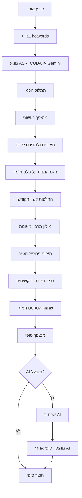

# דוח מיפוי שרשרת התמלול והלמידה

**פרויקט:** `chai-transcribe`  
**תאריך הבדיקה:** 2026-09-02  
**ענף:** `main`  
**Commit ב-GitHub:** `31d063481a385416e475f1d01580ca171bd31652`  
**סוג העבודה:** בדיקת קריאה בלבד, ללא שינוי התנהגות המערכת, ללא migration, ללא מחיקת נתונים וללא הפעלת אימון חדש.

---

## 1. מסקנה מנהלית

המערכת אינה מערכת אחת פשוטה וגם אינה אוסף אקראי שבו כל רכיב מוחק תמיד את האחר. בפועל יש:

1. **צינור מרכזי אחד** שבו משתמשת מעבדת התמלול החדשה.
2. **מספר שכבות ידע ותיקון בתוך הצינור**, שפועלות בסדר קבוע ויכולות לשנות תוצאה של שכבה קודמת.
3. **נתיב ישן ונפרד בצד Python**, שנשאר בקוד אך אינו נגיש כרגע דרך הנתיב הרגיל של האפליקציה.
4. **מערכות אחסון מקבילות** לתיקונים: תיקונים נלמדים כלליים, מילון מרכזי, פרופיל הגייה, כללי לשון הקודש, כללים צורניים קשיחים, ו-AI.
5. **לוגים ברמת שלב**, אבל עדיין אין trace סיבתי מלא ברמת מילה שמציג: איזו מילה השתנתה, באיזה מופע, על ידי איזה כלל, מאיזה מאגר, באיזו פונקציה ובאיזו שורת קוד.

לכן אפשר לדעת את סדר השלבים ואת מקור המערכות, ואפשר להוכיח התנגשויות בבדיקות קטנות. עדיין אי אפשר לקבל מהלוג הקיים לבדו הסבר מלא לכל מילה בתמלול אמיתי.

### מצב לפי תחומים

| תחום | מצב נוכחי | מסקנה |
|---|---|---|
| צינור מרכזי | קיים ומוגדר | תקין מבנית, אך בעל נקודות דריסה |
| מנצפ״ך | נאכף בתחילת הצינור, בסופו ואחרי AI | התוצר האחרון מוגן צורנית |
| תיקונים אנושיים | נשמרים ומופעלים | אינם בעלי עדיפות מוחלטת מול AI |
| מילון מרכזי | קיים מקומית ובענן | מועמדים לא מאומתים אינם מופעלים אוטומטית |
| כללי לשון הקודש | קיימים בדפדפן וגם בשרת ישן | שתי מערכות שונות, לא מקור אמת אחד |
| Gold | יש מסלול אישור | השמירה מפוצלת בין Supabase לבין דיסק מקומי |
| LoRA | תשתית קיימת | אין כרגע מודל LoRA פעיל שעבר את שער האיכות |
| לוגים | קיימים 268 אירועים בענן | טובים למעקב שלבים, לא מספיקים להסבר סיבתי לכל מילה |
| Benchmark | יש השוואות WER/CER | חסר snapshot מלא של המונחים וההגדרות הישנות |

---

## 2. מה נבדק בפועל

### 2.1 בדיקות קוד ומבנה

- מיפוי כל הפונקציות שמשנות טקסט בצינור המרכזי.
- מיפוי מקורות הנתונים, מתגים, writers ו-readers.
- איתור כל הקריאות הישירות לצינור המרכזי ולנתיב הישן.
- מיפוי Gold, Human Review ו-LoRA.
- מיפוי לוגי `asr_pipeline_events` והנתונים שנשמרים בהם.
- בדיקת סטטוס Git והשוואה מול `origin/main`.

### 2.2 בדיקות אוטומטיות

| בדיקה | תוצאה |
|---|---:|
| בדיקות דינמיות ייעודיות לסדר הצינור והדריסות | 10/10 עברו |
| חבילת unit ממוקדת | 103/103 עברו |
| כל בדיקות ה-unit | 275/275 עברו |
| TypeScript `tsc --noEmit` | עבר, 0 שגיאות |
| Production build | עבר, 52.05 שניות |
| Python training routes | 14/14 עברו |
| Python transcript quality | 3/3 עברו |
| Playwright headless למעבדת התמלול | 10/10 עברו, 22.4 שניות |

הערה: בדיקות Playwright משתמשות ב-mocks ל-Supabase ולמנוע התמלול. הן מוכיחות את זרימת הממשק והחוזים, אך אינן מוכיחות שמירה חיה בענן או איכות תמלול חיה.

### 2.3 בדיקות מצב חי

- שרת Vite המקומי הגיב ב-`http://localhost:8080/transcription-lab`.
- שרת התמלול המקומי הגיב ב-`http://127.0.0.1:3000/health`.
- זוהתה סביבת CUDA עם RTX 5050.
- נקראו ללא שינוי נתוני SQLite המקומיים של לשון הקודש.
- נקראו ללא שינוי טבלאות Supabase הרלוונטיות.
- הורצה בדיקת תמלול חוזרת על קטע Gold אמיתי שנמצא בדיסק המקומי.

---

## 3. מצב Git והיקף הבדיקה

`HEAD` המקומי ו-`origin/main` מצביעים שניהם על:

```text
31d063481a385416e475f1d01580ca171bd31652
```

עם זאת, עץ העבודה המקומי מכיל שינויים שטרם נמצאים ב-commit. לכן יש להבחין בין שתי תמונות:

- **GitHub / בדיקת הענן:** בודקת את ה-commit שצוין.
- **הבדיקה המקומית:** בודקת את עץ העבודה הפעיל, כולל השינויים המקומיים.

אין לראות בבדיקת ה-commit בענן הוכחה להתנהגות של קוד מקומי שטרם נדחף.

### 3.1 אימות עצמאי בענן

נפתחה משימת ענן נפרדת על המאגר הציבורי ועל ה-commit המדויק. המשימה רצה ללא גישה למחשב המקומי, ל-Supabase, ל-SQLite, ל-CUDA או לאודיו המקומי, וללא כתיבה למאגר.

תוצאות סביבת הענן:

| בדיקה | תוצאה |
|---|---:|
| `HEAD == origin/main == 31d063...` | עבר |
| עץ העבודה בענן נקי | עבר |
| `npx tsc --noEmit` | עבר |
| `npm run build` | עבר |
| `npm run test:unit` | 49 קבצים, 233 בדיקות עברו |
| `npm run test:quality-gate` | 7 קבצים, 34 בדיקות עברו |
| בדיקות Python זמינות | 3 בדיקות transcript quality עברו |
| יתר בדיקות Python | חלקי: חסרו `flask`/`faster_whisper` בסביבת הענן |
| Playwright | נחסם לפני הרצה: Chromium לא מותקן בסביבת הענן |
| GPU, אודיו, Supabase ו-SQLite | לא הורצו בענן, לפי הגדרת המשימה |

בדיקות הענן אינן מחליפות את הבדיקות המקומיות. הן מספקות ביקורת עצמאית של ה-commit שפורסם, ואילו הבדיקות המקומיות מכסות את הקוד החדש ואת רכיבי המחשב.

### 3.2 הבדלים בין GitHub לבין עץ העבודה המקומי

האימות בענן מצא שב-commit שפורסם סדר הצינור עדיין היה ישן יותר: definitive, learned, profile, vocabulary, LK, ושכבת AI הופעלה בנפרד בעיקר דרך `Index.saveToHistory`.

בעץ העבודה המקומי נמצאו שינויים שטרם נדחפו:

- `TranscriptionKnowledgeOptions` מקבל `loshonKodesh` ו-`ai` מפורשים.
- מעבדת A/B מעבירה את ה-toggle שלה ישירות לצינור הידע.
- שכבת AI נכנסה להמשך הקנוני `applyTranscriptionKnowledgeWithAi`.
- מנצפ״ך נאכף לפני הכללים, בסוף הכללים ואחרי AI.
- שונה סדר LK, vocabulary, profile והכללים הקשיחים.

לכן ממצא הענן שלפיו toggle ה-LK במעבדה לא שולט ב-post-processing **תקף ל-GitHub אך כבר תוקן מקומית**. אין לפרסם שהבעיה תוקנה בפריסה עד שהשינויים המקומיים יעברו review, commit, push ופריסה.

### 3.3 ממצאי הענן שנבדקו שוב ועדיין פתוחים מקומית

| ממצא | ראיית קוד נוכחית | מצב |
|---|---|---|
| hotwords עוברים ל-Gemini אך לא לרוב ספקי הענן | `src/lib/retranscriptionRunner.ts:141-180`; בענף הכללי נשלחים file, key ושפה בלבד | פתוח |
| Groq Edge Function יודעת לקבל hotwords אך caller אינו שולח | `supabase/functions/transcribe-groq/index.ts:47-58,122-132` מול `retranscriptionRunner.ts:164-169` | פתוח |
| הטקסט משתנה אך timings נשארים גולמיים | `src/lib/transcriptionPipeline.ts:196-214,259-269` | פתוח |
| Groq מנקה חזרות בטקסט בלי ליישר timings | `supabase/functions/transcribe-groq/index.ts:183-195` | פתוח |
| פסקה שנצפתה ב-segment נעלמת ב-done | `server/transcribe_server.py:1926-1957` ו-`src/hooks/useLocalServer.ts:783-827` | פתוח |
| כיבוי הגייה אישית אינו מבטל hotwords של profile | `src/lib/transcriptionHotwords.ts:52-54` | פתוח |
| כל עריכה ידנית בעורך נשלחת ללמידה אחרי 2 שניות | `src/pages/TextEditor.tsx:1605-1620` | פתוח |
| baseline מקומי כולל bias עברי ברירת מחדל | `server/transcribe_server.py:251-295`, במיוחד שורה 275 | פתוח/דורש הגדרה מפורשת של baseline |
| המעבדה משתמשת ב-`/transcribe`, הייצור ב-`/transcribe-stream` | `src/lib/transcriptionPipeline.ts:89-108`; `server/transcribe_server.py:1370,1554` | פתוח |
| Human Review Gold עובר פחות בקרות מהאישור המלא | `TranscriptionLab` מול `referenceAudioLearning` ו-`training_routes.py` | פתוח |
| הפעלת LoRA תומכת `force` ומסלול manifest ישיר | `server/training_routes.py` | פתוח אך אינו מופעל מה-UI הרגיל |

### 3.4 משמעות ההבדל בין `/transcribe` לבין `/transcribe-stream`

זה אינו רק הבדל בתצוגת התקדמות:

- המעבדה קוראת ל-`/transcribe` ומקבלת תשובה אחת.
- מסלול ההעלאה הרגיל משתמש ב-`/transcribe-stream`, presets ופרמטרים נוספים.
- ברירות המחדל והזרימה אינן בהכרח זהות.

לכן A/B במעבדה אינו עדיין שחזור מלא של התנהגות הייצור. לפני החלטת קידום מודל, שתי הזרימות צריכות להשתמש באותו adapter קנוני או לפחות לשמור ולדווח את כל הפרמטרים השונים.

### 3.5 פער בין הטקסט הסופי לתזמוני המילים

הצינור מחזיר:

- `text`: אחרי כל שכבות הידע ואולי AI.
- `wordTimings`: כפי שהתקבלו מהמנוע לפני אותן החלפות.

אם החלפה משנה את מספר המילים, מפצלת ביטוי, מאחדת מילים או משכתבת משפט, אין עוד התאמה מובטחת בין מילה N לזמן N. זה משפיע על:

- לחיצה על מילה וניגון מהמיקום שלה.
- חיתוך clips ל-Gold.
- Human Review לפי שורות.
- הדגשת מילה בזמן נגינה.
- כל מדידה המניחה קשר בין span טקסטואלי לאודיו.

זהו סיכון מבני מאומת. נדרש alignment מחדש או שמירת שתי שכבות נפרדות: תמלול גולמי מתוזמן וטקסט מתוקן עם mapping ביניהן.

### 3.6 אובדן פסקאות בזרם CUDA

בכל אירוע segment השרת מחשב `paragraphBreak`, והלקוח מוסיף מעבר. בסיום, השרת יוצר `full_text` באמצעות חיבור כל המקטעים ברווח רגיל בלבד. הלקוח מחליף את הצבירה החלקית ב-`evt.text`, ולכן מעברי הפסקה נעלמים.

זוהי דוגמה מדויקת לדריסה שאפשר לזהות באמצעות trace: המידע נוצר בשלב segment, אך אובד בשלב done.

### 3.7 למידה אוטומטית מעריכה עריכה כהוכחת ASR

`TextEditor.handleEditorChange` שומר גרסה ואחרי debounce קורא ל-`learnCorrections` על ההפרש מה-baseline. הקוד מנסה למנוע זיהום משכתוב AI באמצעות baseline ייעודי, אך עדיין אינו מבחין באופן מלא בין:

- תיקון שגיאת זיהוי קול.
- עריכה לשונית.
- שינוי פיסוק או חלוקת פסקאות.
- ניסוח מחדש.
- השלמת מידע שלא נאמר באודיו.

לכן הנתונים שנאספים הם evidence, לא Gold אקוסטי אוטומטי. לפני אימון קולי צריך classifier של סוג העריכה או אישור אנושי מפורש שהטקסט אכן נאמר באודיו.

---

## 4. תרשים הצינור המרכזי

התרשים הבא מתאר את **עץ העבודה המקומי בזמן הבדיקה**. ה-commit הקיים ב-GitHub מכיל גרסה מוקדמת יותר של הסדר, כמפורט בסעיף 3.2.



נקודת המפתח: `hotwords` משפיעים בזמן זיהוי הקול. כל השכבות שאחריהם משנות טקסט שכבר נוצר.

---

## 5. סדר השלבים המדויק

הפונקציה המרכזית היא `applyTranscriptionKnowledge` בקובץ `src/lib/transcriptionKnowledge.ts`.

| סדר | שלב | פונקציה | מיקום | האם משנה טקסט | מי יכול לשנות אחריו |
|---:|---|---|---|---|---|
| 0 | בניית מונחי הטיה | `buildTranscriptionHotwords` | `src/lib/transcriptionHotwords.ts:22` | משפיע על פענוח האודיו | כל שלבי הטקסט |
| 1 | תמלול | `runTranscriptionPipeline` | `src/lib/transcriptionPipeline.ts:133` | יוצר את הטקסט הגולמי | כל הבאים |
| 2 | מנצפ״ך ראשוני | `normalizeHebrewFinalLettersDetailed` | `src/lib/transcriptionKnowledge.ts:85` | כן | כל הבאים |
| 3 | תיקונים נלמדים | `applyLearnedCorrections` | `src/lib/transcriptionKnowledge.ts:86-88` | כן | LK, מילון, פרופיל, כללים, AI |
| 4 | מסכת הגנה | `protectLearnedOutputs` | `src/lib/transcriptionKnowledge.ts:50-74` | מחליפה זמנית בטוקנים | שחזור מאוחר |
| 5 | לשון הקודש | `applyLoshonKodeshReplacementsDetailed` | `src/lib/transcriptionKnowledge.ts:95-98` | כן | מילון, פרופיל, כללים, AI |
| 6 | מילון מרכזי | `applyVocabularyCorrections` | `src/lib/transcriptionKnowledge.ts:99-101` | כן | פרופיל, כללים, AI |
| 7 | פרופיל הגייה | `applyProfileCorrections` | `src/lib/transcriptionKnowledge.ts:102-104` | כן | כללים, AI |
| 8 | כללים קשיחים | `applyDefinitiveRulesToText` | `src/lib/transcriptionKnowledge.ts:105-107` | כן | שחזור, מנצפ״ך, AI |
| 9 | שחזור מוגנים | שחזור tokens | `src/lib/transcriptionKnowledge.ts:108` | כן | מנצפ״ך, AI |
| 10 | מנצפ״ך סופי | `normalizeHebrewFinalLettersDetailed` | `src/lib/transcriptionKnowledge.ts:111` | כן | AI בלבד |
| 11 | שכתוב AI אופציונלי | `applyLoshonKodeshAI` | `src/lib/transcriptionKnowledge.ts:144-160` | כן, יכול לשכתב משפט מלא | מנצפ״ך סופי בלבד |
| 12 | שער צורני אחרון | `normalizeHebrewFinalLettersDetailed` | `src/lib/transcriptionKnowledge.ts:164` | כן | אף שכבה |

### מסקנה על סדר הסמכויות

- מנצפ״ך הוא הכלל היחיד שמקבל בפועל את המילה האחרונה בתוצר.
- AI מקבל סמכות לשנות תיקונים אנושיים, מילון, פרופיל וכללי לשון הקודש.
- תיקון אנושי נלמד מוגן חלקית מהשכבות הדטרמיניסטיות, אך אינו מוגן מ-AI.
- פרופיל הגייה פועל אחרי המילון ולכן יכול להחליף את תוצאת המילון.

---

## 6. מיפוי מערכות הידע והתיקון

### 6.1 תיקונים נלמדים כלליים

| מאפיין | ערך |
|---|---|
| מאגר מקומי | `localStorage: transcription_corrections` |
| executor | `applyLearnedCorrections` |
| קובץ | `src/utils/correctionLearning.ts:309` |
| writer מרכזי | `learnFromCorrections`, שורה 248 |
| סף ברירת מחדל | לפי אפשרויות הקריאה; הצינור משתמש בברירת המחדל |
| הכרעת התנגשות | נבחר התיקון החזק הראשון לכל מקור מנורמל |

כותבים למאגר זה נמצאו בין השאר ב:

- `src/pages/AsrTraining.tsx:531,741`
- `src/hooks/useCorrectionLearning.ts:44`
- `src/utils/talmudicCorrectionsSeed.ts:42`
- `src/components/RichTextEditor.tsx:374,396`
- `src/components/SpellCheckView.tsx:165`
- `src/components/PlayerTranscriptEditor.tsx:105,122,155`
- `src/components/SyncMirrorLayout.tsx:696,918,954`
- `src/lib/personalPronunciationModel.ts:161`

### 6.2 המילון המרכזי

| מאפיין | ערך |
|---|---|
| מאגר מקומי | `localStorage: custom_vocabulary` |
| מאגר ענן | `public.torah_lexicon_terms` |
| executor | `applyVocabularyCorrections` |
| קובץ | `src/utils/customVocabulary.ts:434` |
| ברירת מחדל | מופעל |
| תנאי להחלפה | `verified` וביטחון של 0.85 לפחות |

ממצא חשוב: ערך במצב `candidate` אינו מתקן אוטומטית את הטקסט. זה מנגנון הגנה נכון.

### 6.3 פרופיל הגייה אישי

| מאפיין | ערך |
|---|---|
| מאגר | `localStorage: pp_profile_<id>_corrections` |
| executor | `applyProfileCorrections` |
| קובץ | `src/lib/pronunciationProfiles.ts:427` |
| סף | 0.6 |
| מקסימום תיקונים בריצה | 50 |

ב-`src/lib/personalPronunciationModel.ts:144-180` אימות אנושי יחיד יכול לכתוב את אותו תיקון גם למאגר הכללי וגם לפרופיל. זו כפילות סמכות מכוונת בקוד, אבל היא מקשה לדעת מי אחראי לשינוי.

### 6.4 כללי לשון הקודש בדפדפן

| מאפיין | ערך |
|---|---|
| הגדרות | `src/lib/loshonKodesh.ts:254-264` |
| executor | `applyLoshonKodeshReplacementsDetailed` |
| קובץ | `src/lib/loshonKodesh.ts:516-574` |
| תיקון מנצפ״ך פנימי | `src/lib/loshonKodesh.ts:563-569` |

מלאי נוכחי בעץ העבודה:

- 56 החלפות בסיס.
- 46 hotwords בסיסיים.
- 6 מילונים נושאיים, 5 מופעלים.
- 92 hotwords גולמיים מהמילונים המופעלים.
- 138 hotwords גולמיים בסך הכול, 134 ייחודיים.
- כפילויות גולמיות: `מצוה`, `תורה`, `תפילה`, `ברכה`.
- כל מילוני הנושא מכילים כרגע `replacements: []`; הם משמשים כ-hotwords בלבד.
- הקטגוריות `kamatz` ו-`general` קיימות בממשק אך אינן שולטות כרגע באף כלל.

### 6.5 מילון הזרע התורני

`src/data/torahLexiconSeed.ts` מכיל 208 מונחים קנוניים ייחודיים:

| קטגוריה | כמות |
|---|---:|
| מסכתות | 37 |
| תנאים | 25 |
| אמוראים | 32 |
| מפרשים | 27 |
| ספרות רבנית | 17 |
| ארמית | 49 |
| מושגים | 21 |

### 6.6 כללים צורניים קשיחים

| מאפיין | ערך |
|---|---|
| קובץ | `src/utils/hebrewRuleEngine.ts` |
| executor | `applyDefinitiveRulesToText`, שורה 242 |
| מתג | `definitive_hebrew_rules_enabled` |
| ברירת מחדל | מופעל |
| כללים | אות סופית נדרשת, אות סופית במקום שגוי, רווחים |

### 6.7 מנצפ״ך

הפונקציה `normalizeHebrewFinalLettersDetailed` נמצאת ב-`src/lib/loshonKodesh.ts:470`.

היא ממירה:

- `כ → ך`, `מ → ם`, `נ → ן`, `פ → ף`, `צ → ץ` בסוף מילה.
- `ך → כ`, `ם → מ`, `ן → נ`, `ף → פ`, `ץ → צ` בתוך מילה.

הבדיקות הייעודיות הוכיחו את כל חמשת הזוגות:

- אות רגילה בסוף מילה הופכת לסופית.
- אות סופית באמצע מילה הופכת לרגילה.
- אות סופית תקינה בסוף נשארת ללא שינוי.
- אחרי שכתוב AI מופעל שער מנצפ״ך נוסף.

לכן ההמלצה נשארת: אפשר להשתמש בנרמול מוקדם כדי לעזור להתאמות אחרות, אבל **השער הקובע חייב להיות בסוף**, כפי שקורה כרגע.

### 6.8 שכבת AI

| מאפיין | ערך |
|---|---|
| caller מרכזי | `src/lib/transcriptionKnowledge.ts:144` |
| executor | `src/lib/loshonKodesh.ts:585` |
| Edge Function | `supabase/functions/loshon-kodesh-ai/index.ts` |

AI מקבל את התוצאה הדטרמיניסטית ויכול להחזיר משפט אחר. לאחר מכן נאכף רק מנצפ״ך. אין כיום gate שמבטיח שתיקון אנושי מאומת יישאר ללא שינוי.

---

## 7. בניית hotwords והשפעה על הקול

`buildTranscriptionHotwords` נמצא ב-`src/lib/transcriptionHotwords.ts:22`.

סדר העדיפויות:

1. מונחים ידניים, ציון 1000.
2. מילון מאומת, מילון אישי והקשר.
3. תיקונים נלמדים, אם המילון האישי מופעל.
4. פרופיל הגייה.
5. רשימת לשון הקודש.
6. מיון, נרמול, הסרת כפילויות והגבלה ל-60.

זהו הבדל עקרוני:

- **hotword** אומר למנוע הקולי: “המילה הזאת סבירה בהקלטה הזאת”.
- **replacement** אומר לאחר התמלול: “אם נוצר X, החלף ל-Y”.

הראשון תלוי באודיו ובהקשר; השני עלול להיות מסוכן אם אינו כלל מוחלט או תיקון מאומת עם תנאים.

---

## 8. הנתיב הישן בצד Python

קיים endpoint נוסף:

```text
POST /lk/transcribe
```

מיקומים:

- `server/transcribe_server.py:5719`
- קריאות ב-`src/pages/LashoKodesh.tsx:144,1010,1119`

בדף הישן, התשובה מהשרת עוברת לאחר מכן שוב דרך `applyLoshonKodeshReplacements` בדפדפן. כלומר הנתיב הישן מסוגל לבצע post-processing פעמיים.

עם זאת, הנתיבים הרגילים באפליקציה מפנים למעבדה החדשה:

- `/transcription-lab` נטען ישירות.
- `/lashon-kodesh` מפנה ל-`/transcription-lab?mode=lashon-kodesh`.
- `/asr-training` מפנה למעבדה.

מסקנה: נתיב Python הישן אינו חלק מהזרימה הרגילה הנוכחית, אך הוא חוב טכני ומקור בלבול. אין למחוק אותו לפני בדיקת תלות מלאה וייצוא נתונים.

### 8.1 מפת מסלולי התמלול בפרויקט

| מסלול | פעיל למשתמש | משתמש בצינור הקנוני | הבדל או סיכון |
|---|---|---|---|
| `Index` / העלאת קובץ רגילה | כן | כן | שומר היסטוריה ומאפשר AI LK אופציונלי |
| `RetranscribeDialog` | כן | כן | מפעיל את הצינור דרך adapter תמלול חוזר; הגדרות AI תלויות caller |
| `TranscriptionLab` | כן | כן מקומית | A/B משתמש ב-`/transcribe`, לא באותו endpoint של הייצור |
| Live transcription | כן | לבסוף דרך `saveToHistory` | צבירת chunks ו-dedup קודמים לצינור; תמלול מלא יכול להחליף את הצבירה |
| Speaker diarization | כן | לא בכל הזרימה | מרכיב טקסט עם דוברים במסלול עצמאי |
| YouTube job מקומי | כן | לא בכל נתיבי הפתיחה | תוצר job יכול להגיע לעורך ישירות |
| `AsrTraining.tsx` הישן | לא מנותב | לא | משתמש בכללים רחבים ובמנגנון ישן |
| `LashoKodesh.tsx` + `/lk/transcribe` | לא מנותב | לא | SQLite וכללי שרת נפרדים, כולל אפשרות post-processing כפול |

מסקנה: קיימת ליבה קנונית, אך עדיין אין adapter יחיד שמחייב את כל מסלולי הקלט לעבור בדיוק באותו תהליך ובאותם פרמטרים.

---

## 9. מצב SQLite המקומי של לשון הקודש

מסד: `server/lk_data.db`.

| טבלה | שורות |
|---|---:|
| `lk_dictionary` | 0 |
| `lk_sessions` | 0 |
| `lk_grammar_rules` | 14 |

מצב הכללים:

- כללים 1-8 הישנים כבויים כעת.
- חלק מהישנים היו בכיוון שגוי, למשל `תורה → תוירה`, `שבת → שבס`, `יום טוב → יום טויב`.
- שניים מהם היו no-op.
- כללים 1641-1646 מופעלים ובכיוון תיקון:
  - `תוירה → תורה`
  - `קוידש → קודש`
  - `מוישה → משה`
  - `שאבעס → שבת`
  - `שאבס → שבת`
  - `אמעס → אמת`

לכן הטענה הישנה “8 כללים פעילים, שניים no-op” אינה עדכנית. המצב הנוכחי הוא **6 כללים פעילים, וכולם משנים בפועל**.

עם זאת, `lk_dictionary` ו-`lk_sessions` עדיין ריקות. לולאת הלמידה השרתית הישנה לא צברה נתונים.

---

## 10. מצב Supabase שנמדד

### 10.1 כמויות

| ישות | כמות |
|---|---:|
| תמלולים | 14 |
| תמלולים עם נתיב אודיו | 9 |
| אירועי pipeline | 268 |
| ניסויי pipeline | 9 |
| comparison runs | 28 |
| מונחי מילון ענן | 3 |
| תיקונים נלמדים בענן | 375 |
| training runs ישנים | 9 |
| pending corrections | 0 |

### 10.2 מילון ענן

שלושת הערכים הם מועמדים בביטחון 0.6 ובשימוש 0:

- `תלהוב תהלהו → תהלה`
- `ארומך → ארוממך`
- `אגמור → הגמרא`

כיוון שהם מועמדים ולא מאומתים, הם אינם אמורים להחליף אוטומטית בצינור המרכזי.

### 10.3 תיקונים נלמדים בענן

מתוך 375 רשומות:

- 272 בביטחון 0.6 ומעלה.
- 110 בביטחון 0.85 ומעלה.
- ל-26 מקורות קיימות כמה מטרות שונות.
- 211 נוצרו כ-`manual`.
- 17 מ-`seed:talmudic`.
- 13 מ-`context-menu`.
- 24 מ-`context-menu-context`.
- 110 מ-`lovable`.
- קיימת קבוצת מקור ריק עם 9 מטרות. הסינון הנוכחי מונע הפעלה שלה, אבל הנתון עצמו אינו נקי.

המשמעות: המאגר מכיל ידע שימושי, אך גם סתירות ונתונים שאסור להפעיל אוטומטית בלי quarantine והכרעה.

### 10.4 אירועי pipeline

268 האירועים מתחלקים בין שלבים כגון source, configuration, upload, transcription, knowledge, metrics, quality-gate, review ו-complete.

נמצאו:

- 26 זוגות A/B.
- 9 שיפורים.
- 4 רגרסיות.
- 13 תוצאות שהגיעו ל-review.
- 3 שמירות Human Review.
- 3 הוספות candidate למילון.
- אירוע Gold אחד.
- 4 אירועי error.

267 מתוך 268 מכילים fingerprint. זה טוב לשחזור זהות הריצה, אבל אינו מחליף snapshot של כל המונחים והכללים.

---

## 11. Gold, Human Review ו-LoRA

### 11.1 מה קורה באישור Gold

ב-`src/pages/TranscriptionLab.tsx`:

- `persistGoldSource`, שורות 630-667, שומר מקור מלא בענן רק כאשר המקור מוגדר כ-cloud.
- `approveGold`, שורות 669-743, דורש תזמוני מילים, יוצר clips ומעביר אותם ל-`addApprovedLoraPair`.
- `addApprovedLoraPair` נמצא ב-`src/hooks/useLoraTraining.ts:69-84` ושולח לשרת המקומי.
- `server/training_routes.py:275-334` שומר clips בדיסק המקומי, בטווח 0.25-35 שניות, עם group identity ו-dedup לפי hash.

מכאן ש-Gold מתפצל לשני יעדים:

1. מקור מלא ב-Supabase, אם השמירה בענן אפשרית.
2. clips לאימון בדיסק המקומי.

אין כרגע registry יחיד שמוכיח אטומית ששני החלקים נשמרו יחד.

### 11.2 המצב המקומי של `approved-ground-truth`

| מדד | ערך |
|---|---:|
| קובצי אודיו | 19 |
| קובצי טקסט | 19 |
| metadata מלא | 4 |
| metadata חסר | 15 |
| recording groups | 2 |
| זמן כולל | 153.18 שניות |
| Gold אנושי מאומת | 1 |
| provenance לא ידוע | 18 |
| מוכן לאימון | לא |

נמצא clip אמיתי אחד עם `quality=Gold`, מקור `human-approved`, group identity ומשך 12.63 שניות.

### 11.3 מודל LoRA

- dataset `psalm-chant-ashkenazi` מכיל 99 clips משתי הקלטות.
- ריצה `psalm_chant_ashkenazi_v1_fixed` שיפרה WER מ-80.30% ל-73.98%.
- באותה ריצה CER הורע מ-39.49% ל-41.38%.
- `active_model.json` המקומי מצביע על המודל, אך endpoint החי `/training/active-model` מדווח שאין מודל פעיל ושההפעלה הושעתה כי אין מועמד שעבר יחד את שער WER ו-CER על holdout בר-השוואה.

מסקנה: יש תשתית אימון וניסוי, אבל אין כיום LoRA פעיל שניתן לומר שהוא משפר את המערכת.

---

## 12. בדיקות הדריסה שבוצעו

נכתבו והרוצו בדיקות audit זמניות, ללא שינוי קוד הייצור. כל 10 הבדיקות עברו.

### 12.1 מה הוכח

1. מנצפ״ך תקין בכל חמשת זוגות האותיות.
2. מנצפ״ך נאכף גם אחרי AI.
3. מסכת ההגנה על תיקון נלמד פועלת באופן גלובלי ועלולה לחסום כלל ביטוי במקום אחר.
4. בקרה עם מילה שאינה חלק מהביטוי אינה שוברת את הכלל.
5. פלט ישיר של תיקון נלמד מוגן מפני כלל LK מתנגש.
6. candidate במילון אינו מופעל; verified כן מופעל.
7. פלט LK יכול להיכנס לכלל מילון.
8. פרופיל יכול להחליף תוצאה של המילון.
9. AI יכול להחליף תיקון אנושי נלמד.
10. הגדרת ריצה מפורשת גוברת על הגדרת LK הגלובלית.

### 12.2 פגם מסכת ההגנה

ב-`src/lib/transcriptionKnowledge.ts:57-61` מבוצע למעשה:

```ts
protectedText = protectedText.split(corrected).join(token)
```

כל מופע של המחרוזת המתוקנת מוגן, לא רק המופע שתוקן על ידי מנגנון הלמידה. אם מילה שכיחה כמו `הוא`, `כל` או `מה` הופיעה כתוצאת תיקון במקום אחד, כל מופע שלה בטקסט מוסווה זמנית. כתוצאה מכך כלל LK רב-מילי במקום אחר עלול לא להתאים.

זהו פגם מוכח. הוא אינו הוכחה שכל תמלול נפגע, אך הוא מוכיח שהמנגנון יכול לחסום כלל שאמור לפעול.

### 12.3 AI מול תיקון אנושי

הבדיקה הוכיחה ששכבת AI יכולה להחזיר נוסח אחר לאחר שהתיקון האנושי כבר הופעל. לאחר AI נאכף רק מנצפ״ך. לכן “תיקון אנושי מאומת תמיד מנצח” אינו כלל שקיים כיום.

---

## 13. בדיקת אודיו אמיתי

נבדק הקובץ המקומי:

```text
server/lora_runs/datasets/approved-ground-truth/audio/00019.wav
```

טקסט האמת הוא קטע “אני קורא כעת את המושגים הבאים: אשרי יושבי ביתך...”.

### תוצאות

| מנוע/מצב | WER | CER | הערה |
|---|---:|---:|---|
| Turbo, ללא LK | 88.57% | 63.89% | בסיס מקומי חוזר |
| Turbo, LK כללי ללא מונחי הניסוי המקוריים | 100% | 64.58% | התקבלה חזרתיות `אשריהו...` |
| Full, ללא LK | 91.43% | 61.81% | בסיס full |
| Full, LK כללי בלבד | 91.43% | 63.89% | לא נצפה שיפור |

### מדוע אין זו סתירה לניסוי הקודם

בניסוי הענן ההיסטורי הטוב של אותו קובץ:

- A: WER 91.43%, CER 59.72%.
- B: WER 20%, CER 18.06%.
- אירוע ה-knowledge דיווח 0 שינויים בכל שכבות הטקסט.
- B השתמש ב-60 hotwords, כולל המונחים הידניים של ההקלטה.

לכן השיפור ההיסטורי הגיע בשלב פענוח האודיו באמצעות מונחי הטיה, לא באמצעות replacements לאחר התמלול.

ההרצה החוזרת לא הצליחה לשחזר את 60 המונחים המדויקים, כי הרשומה ההיסטורית שמרה רק `hotwordsCount: 60` ולא את הרשימה עצמה. מכאן נובעת המלצה קריטית: בכל ניסוי צריך לשמור snapshot מלא או hash בר-שחזור של המונחים וה-prompt.

### פער בבקרת חזרתיות

ב-`server/transcribe_server.py:1477-1490` קיימת בדיקה עם `is_degenerate_transcript`. אולם `server/transcript_quality.py:18-25` מחזיר `false` כאשר יש פחות מ-50 tokens. הפלט הבעייתי הכיל 22 tokens ולכן לא נתפס.

זהו פער מוכח בבקרת איכות של פלט קצר.

---

## 14. מה הלוגים הקיימים יודעים ולא יודעים להסביר

`src/lib/pipelineAudit.ts` שומר עד 1,000 אירועים ב-`localStorage: asr_pipeline_events_v1` ומנסה לשמור אותם גם בענן.

### מה כן נשמר

- זהות ניסוי ו-variant.
- שלב pipeline.
- מנוע ומודל.
- מדדים כגון WER/CER.
- ספירות כלליות של תיקונים.
- fingerprints וסטטוס ריצה.

### מה לא נשמר במבנה אחיד

- מיקום המילה או טווח התווים שהשתנה.
- `before` ו-`after` לכל מופע בנפרד.
- שם המאגר שממנו הגיע הכלל.
- קובץ, פונקציה ושורת קוד של executor.
- priority וסיבת הכרעה במקרה של התנגשות.
- מי שינה שוב את אותה מילה בשלב מאוחר יותר.
- הרשימה המלאה של hotwords וה-prompt לכל ניסוי ישן.
- קשר אטומי בין מקור Gold בענן לבין clips מקומיים.

אובייקט `changes` ב-`src/lib/transcriptionKnowledge.ts:123-131` כולל כיום רק שכבה, מקור, יעד, ספירה ולעיתים `ruleId`. זה שימושי אך אינו trace סיבתי מלא.

---

## 15. כפילויות והתנגשויות

### 15.1 כפילויות מבניות

| כפילות | מצב | סיכון |
|---|---|---|
| מנצפ״ך ב-LK, ב-hebrewRuleEngine ובשער הצינור | פעיל בכמה מקומות | קושי בייחוס; התוצאה הסופית כרגע תקינה |
| תיקון אנושי נכתב גם לכללי וגם לפרופיל | פעיל | אותה סמכות בשני מאגרים |
| LK בדפדפן ו-LK ב-Python/SQLite | שתי מערכות | divergence וחוסר ודאות |
| Gold בענן ו-clips בדיסק | שני יעדים | הצלחה חלקית ללא transaction |
| מונחי LK בסיסיים ומילונים | כפילויות גולמיות | נפתר חלקית על ידי dedup בבניית hotwords |

### 15.2 התנגשויות מוכחות

| התנגשות | תוצאה נוכחית |
|---|---|
| learned מול LK | learned מוגן, אבל ההגנה גלובלית מדי ועלולה לחסום LK במקום אחר |
| LK מול vocabulary | vocabulary פועל אחרון מביניהם ומנצח אם יש התאמה |
| vocabulary מול profile | profile פועל אחרון ומנצח אם יש התאמה |
| כל הדטרמיניסטי מול AI | AI יכול לשכתב |
| AI מול מנצפ״ך | מנצפ״ך הסופי מנצח |

### 15.3 מה אינו כפילות מזיקה כשלעצמו

- רשימת מונחים וקטע אמת אינם אותו דבר: המונחים מכוונים את המנוע ומודדים recall; קטע האמת משמש לחישוב WER/CER ול-Gold.
- baseline A ו-candidate B אינם כפילות: זו השוואה מבוקרת, בתנאי ששומרים את מלוא ההגדרות.
- נרמול מנצפ״ך מוקדם וסופי אינו בהכרח שגיאה: המוקדם מסייע לכללים, והסופי אוכף את החוזה.

---

## 16. דירוג הממצאים

### P0 מותנה: סכנת זיהום Gold או אימון

אם תוצר שעבר שכתוב AI לא מאומת, או clip ללא provenance, נכנס ל-Gold או לאימון כאמת — זו השחתת נתוני אימון. כרגע נמצא ש-18 מתוך 19 clips במאגר `approved-ground-truth` אינם Gold אנושי מאומת במטא-דאטה. אין לאמן על המאגר במצבו הנוכחי.

### P1: מסכת הגנה גלובלית

הגנה על פלט תיקון נלמד מחליפה כל מופע זהה בטקסט ועלולה להשבית כללי ביטוי שאינם קשורים למופע שתוקן.

### P1: AI יכול לדרוס תיקון אנושי

אין סמכות מחייבת של Human Verified מעל AI.

### P1: אין trace סיבתי ברמת מילה

קיימים לוגים ברמת שלב, אך אין יכולת לענות אוטומטית על השאלה “איזה כלל שינה את מילה 17, מאיזה קובץ, ולמה כלל מאוחר שינה אותה שוב”.

### P1: בקרת חזרתיות אינה בודקת פלט קצר

פלט קצר וחזרתי יכול לעבור בלי retry כי הבדיקה מדלגת על פחות מ-50 tokens.

### P1: היסטוריית ניסויים אינה משתחזרת במלואה

נשמר מספר hotwords אך לא הרשימה המלאה. לכן אי אפשר לשחזר בדיוק ניסוי שהראה שיפור גדול.

### P1: טקסט סופי ותזמוני מילים עלולים להיפרד

תיקוני מילים ו-AI משנים את הטקסט, אך ה-word timings נשארים מהטקסט הגולמי. זה מסכן ניגון ממילה, הדגשה וחיתוך Gold.

### P1: מעבדת A/B אינה זהה לנתיב הייצור

המעבדה משתמשת ב-`/transcribe`, ואילו מסלול CUDA הרגיל משתמש ב-`/transcribe-stream` וב-presets. השוואה במעבדה אינה עדיין הוכחת production parity.

### P1: hotwords אינם מגיעים לרוב ספקי הענן

המעבדה בונה אותם, אך `runCloudRetranscription` מעביר אותם בפועל ל-Gemini בלבד. לכן תווית B “עם ידע” אינה בעלת אותה משמעות בכל מנוע.

### P1: מעבר פסקה נדרס בסיום stream

אירועי segment כוללים מעבר פסקה, אך אירוע done מחזיר טקסט מחובר ברווחים ומחליף את הטקסט החלקי.

### P1: למידה מכל עריכה ידנית

עריכה נשמרת כראיית תיקון אחרי debounce גם כאשר היא עריכה לשונית ולא תיקון של מה שנאמר באודיו.

### P1: גרסת GitHub מפגרת אחרי הצינור המקומי

האימות בענן הוכיח שה-commit המפורסם עדיין מכיל את סדר הצינור וה-toggle הישנים יותר. התיקונים המקומיים אינם חלק מהפריסה עד שיעברו review ו-push. זה אינו כשל קוד בפני עצמו, אך הוא פער תפעולי שחייב להופיע בכל דיווח בדיקה.

### P1: מאגר תיקונים מכיל סתירות

26 מקורות עם כמה יעדים, רשומות עם מקור ריק וביטויים הממופים למשפטים שונים דורשים quarantine והכרעה.

### P1: Gold מפוצל בין ענן למקומי

אין registry אטומי יחיד המאשר שהאודיו, הטקסט, התזמונים, ה-clips וה-provenance נשמרו יחד.

### P2: כפילות בין מאגר כללי לפרופיל

אותו אימות אנושי עלול להירשם בשתי מערכות סמכות.

### P2: נתיב LK ישן ונפרד

הנתיב אינו פעיל דרך ה-router הרגיל, אך משאיר מערכת שנייה וכללי SQLite שאינם מקור האמת של המעבדה.

### P2: שכפול מנצפ״ך

התוצאה הסופית עוברת את הבדיקות, אך המימוש מפוזר ומקשה על provenance ותחזוקה.

---

## 17. המלצות לפי סדר עבודה

### שלב 1: להקפיא שינויי התנהגות ולהגדיר חוזה לצינור

לפני תיקון כללים או הוספת מונחים, לקבע מסמך חוזה אחד:

1. מהו הצינור הקנוני.
2. מה סדר השלבים.
3. איזו שכבה רשאית לשנות איזו שכבה.
4. מה נחשב כלל קשיח, ידע סטטיסטי, הצעת AI או תיקון אנושי.
5. מה חייב להישמר כדי לשחזר ניסוי.

### שלב 2: להוסיף Trace Ledger ללא שינוי התוצאה

זהו הפיתוח הראשון שמומלץ לבצע לאחר אישור הדוח. הוא צריך להיות observational בלבד.

לכל שינוי יש לשמור:

```text
experimentId
variant
stageIndex
stageName
inputSpan
outputSpan
before
after
ruleId
ruleKind
sourceStore
sourceFile
sourceFunction
codeVersion
confidence
priority
decision
overwrittenBy
```

כך אפשר יהיה להציג לדוגמה:

```text
מילה 17: ארומך
ASR -> ארומך
Vocabulary candidate -> לא הופעל, status=candidate
Profile rule 81 -> ארוממך
AI -> ארוממך, ללא שינוי
Final orthography -> ללא שינוי
```

### שלב 3: להקפיא Benchmark נקי

- לפצל לפי `recordingGroupId`, לא לפי clips אקראיים.
- להפריד term-reading מדיבור טבעי.
- לשמור את ההקלטות הקשות הישנות ל-eval בלבד.
- לאמן רק על הקלטות מקבוצות אחרות.
- לשמור snapshot מלא של hotwords, prompt, toggles, model hash ו-code commit.

### שלב 3א: לאחד את adapter התמלול של המעבדה והייצור

- להשתמש באותה פונקציית request ובאותם פרמטרים ל-`/transcribe` ול-`/transcribe-stream`, או לבטל אחד מהם.
- להעביר hotwords ו-model override לכל ספק שתומך בהם.
- לדווח במפורש `biasMode=none|default-hebrew|manual|lk`.
- לא לקרוא לריצת A `baseline` אם השרת מוסיף לה הטיה עברית אוטומטית בלי לתעד זאת.

### שלב 3ב: להפריד תזמונים גולמיים מהטקסט המתוקן

- לשמור `rawTranscript + rawWordTimings` כמקור בלתי משתנה.
- לשמור `correctedTranscript` כגרסה נפרדת.
- לייצר mapping של spans או alignment חדש לאחר שינוי מספר מילים.
- לא לחתוך Gold לפי timings גולמיים כאשר הטקסט שנבחר אינו מיושר אליהם.

### שלב 4: לתקן את מסכת ההגנה

רק לאחר שיש trace ובדיקת baseline:

- להגן לפי spans של המופעים שבאמת תוקנו.
- לא לבצע `split/join` גלובלי על כל הטקסט.
- להוסיף regression test לביטוי רב-מילי המכיל מילה שזהה לפלט תיקון במקום אחר.

### שלב 5: לקבוע היררכיית סמכות

הסדר המומלץ:

1. כללי Unicode/orthography קשיחים בסוף.
2. תיקון אנושי מאומת ומקושר לאודיו.
3. מילון מאומת עם scope והקשר.
4. profile אישי.
5. LK heuristic.
6. AI כהצעה או כ-rewrite שנבדק מול constraints, לא כסמכות בלתי מוגבלת.

AI יכול להציע שינוי לתיקון אנושי, אבל לא לשנות אותו בשקט.

### שלב 6: לאחד Gold ו-provenance

יש ליצור registry קנוני אחד שמקשר:

- audio source בענן.
- hash וקובץ מקור.
- transcription version.
- word timings.
- Human Review.
- clips מקומיים או בענן.
- recording group.
- train/eval reservation.
- quality tier.
- model/config/code commit.

שמירה תיחשב מוצלחת רק אם כל החלקים הדרושים נרשמו או סומנו במפורש כ-pending.

### שלב 7: לנקות תיקונים סותרים

- להעביר מקור בעל כמה מטרות ל-`ambiguous`.
- לא להפעיל ambiguous אוטומטית.
- למחוק או להסגר רשומות מקור ריק רק לאחר export וגיבוי.
- להפריד תיקון קולי תלוי הקשר מכלל כתיב מוחלט.
- לא להפוך תיקון חד-פעמי כמו `ילדים → ילדות` לכלל גלובלי.

### שלב 8: להכריע לגבי הנתיב הישן

לאחר מיפוי תלות:

- לייצא את 14 כללי SQLite.
- להשוות מול מקור האמת החדש.
- להעביר רק כללים תקפים ומאומתים.
- להסיר או לארכב את הנתיב הישן רק לאחר בדיקת regression.

### שלב 9: לשפר בקרת פלט קצר

- לא להפסיק בדיקת חזרתיות רק בגלל פחות מ-50 tokens.
- להשתמש בספים מותאמי אורך.
- לבדוק יחס חזרות, diversity ויחס הטיה למונחי prompt.
- לשמור את סיבת ה-retry ב-trace.

### שלב 10: להפריד למידה אקוסטית מעריכה לשונית

- עריכה רגילה בעורך תישמר כהיסטוריית עריכה בלבד.
- תיקון ASR ידרוש סימון “זה מה שנאמר באודיו”.
- שינוי פיסוק, מבנה או ניסוח לא יהפוך אוטומטית לזוג אימון קולי.
- Gemini יכול להציע Silver evidence; רק Human Review מול האודיו יכול לקדם ל-Gold.

---

## 18. בדיקות הקבלה הדרושות לשלב הבא

לפני כל שינוי לוגי, יש לקבע את הבדיקות הבאות:

1. אותה הקלטה ואותן הגדרות מפיקות trace בעל אותו fingerprint.
2. כל שינוי בטקסט מיוחס ל-stage, ruleId, sourceFile ו-span.
3. תיקון אנושי במופע אחד אינו חוסם כלל במקום אחר.
4. AI אינו משנה span אנושי נעול בלי אירוע conflict מפורש.
5. candidate אינו מוחל אוטומטית.
6. ambiguous אינו מוחל אוטומטית.
7. מנצפ״ך תקין בכל התוצר האחרון, כולל אחרי AI.
8. פלט קצר וחזרתי נכשל ב-quality gate או מופעל עליו retry.
9. Gold נשמר עם audio, text, timings, groupId ו-provenance.
10. train/eval אינם חולקים recording group.
11. term-reading ודיבור טבעי מדווחים בנפרד.
12. כל ניסוי שומר את רשימת ה-hotwords בפועל ולא רק ספירה.

---

## 19. מה לא לבצע עדיין

עד השלמת trace ו-Benchmark:

- לא להתחיל אימון LoRA חדש.
- לא להפעיל אוטומטית את 375 התיקונים בענן.
- לא להפוך candidates למאומתים באופן גורף.
- לא להוסיף עשרות replacements חדשים.
- לא למחוק את SQLite או את הדף הישן.
- לא לאחד טבלאות באמצעות migration ללא export ומיפוי.
- לא להסיק ש-LK תמיד משפר או תמיד מזיק מניסוי יחיד.
- לא להשתמש בתמלול Gemini כ-Gold בלי Human Review וקישור לאודיו.

---

## 20. תשובות קצרות לשאלות המרכזיות

### האם המערכת לומדת?

כן. קיימים תיקונים נלמדים, פרופיל אישי, מילון, Human Review ו-Gold. אבל לא כל מה שנשמר מופעל, וחלק מהידע נמצא במאגרים מקבילים.

### האם מערכות דורסות זו את זו?

כן, לפי סדר ידוע. לא כל דריסה היא שגיאה. הבעיות הן שהסמכות אינה תמיד נכונה ושאין trace מלא לכל מופע.

### האם אפשר לגלות זאת באמצעות דוגמאות קטנות?

כן. כך בדיוק הוכחו מסכת ההגנה, דריסת AI, profile מול vocabulary ומנצפ״ך. הבדיקה הקטנה מוכיחה את המנגנון; בדיקת אודיו אמיתי מוכיחה אם הוא מופעל בזרימה חיה.

### האם מנצפ״ך עובד בסוף?

כן. נבדק בכל האותיות, בתוך מילה, בסוף מילה ואחרי AI.

### האם כל מילה שאינה במילון היא בהכרח שגיאה?

לא. ייתכנו שמות, ארמית, קיצורים, הטיות, מספרים או שגיאת מילון. “לא במילון” הוא אות לבדיקה, לא כלל החלפה מוחלט.

### האם כדאי להתמקד בקול?

כן, עיקר השיפור הרצוי צריך להימדד מול אודיו ו-Gold. hotwords, fine-tuning ו-LoRA עוסקים בצד הקולי. כללי טקסט צריכים להישאר מוגבלים לכללים מוחלטים ולתיקונים אנושיים בעלי provenance.

### האם אפשר להמשיך לעבוד בזמן בדיקות ענן?

כן. בדיקת הענן רצה על commit קפוא ונפרד. היא אינה משנה את עץ העבודה המקומי. יש לזכור שכל שינוי מקומי חדש אינו נכלל באותה בדיקת ענן עד commit חדש.

---

## 21. החלטה מומלצת

השלב הבא אינו “עוד כללים” ואינו “עוד אימון”. השלב הבא הוא **Trace Ledger לקריאה בלבד**, שמוכיח לכל מילה את שרשרת הסיבות ומקשר אותה לקובץ ולפונקציה. לאחר שיש baseline ו-trace, מתקנים בסדר הבא:

1. מסכת ההגנה הגלובלית.
2. סמכות AI מול תיקון אנושי.
3. בקרת חזרתיות בפלט קצר.
4. snapshot מלא של ניסויים.
5. registry אחיד ל-Gold ול-provenance.
6. ניקוי תיקונים סותרים.
7. הכרעה והגירה של הנתיב הישן.

כך כל תיקון עתידי יהיה ניתן למדידה: לפני, אחרי, מי שינה, היכן בקוד, ומה קרה ל-WER, CER ו-Term Recall על Benchmark שלא שימש לאימון.

---

## 22. גבולות הוודאות

- מיפוי הקוד, סדר השלבים והבדיקות הדינמיות הם עובדות שנבדקו על עץ העבודה המקומי.
- נתוני Supabase ו-SQLite הם snapshot בזמן הבדיקה ועלולים להשתנות לאחר מכן.
- בדיקת הענן רואה את commit GitHub ולא את השינויים המקומיים שטרם נדחפו.
- השוואת האודיו החוזרת לא שיחזרה את רשימת 60 ה-hotwords ההיסטורית, ולכן אינה שחזור מלא של הניסוי המוצלח.
- לא בוצעו שינויי ייצור, migrations, מחיקות, אימון או הפעלת מודל.
